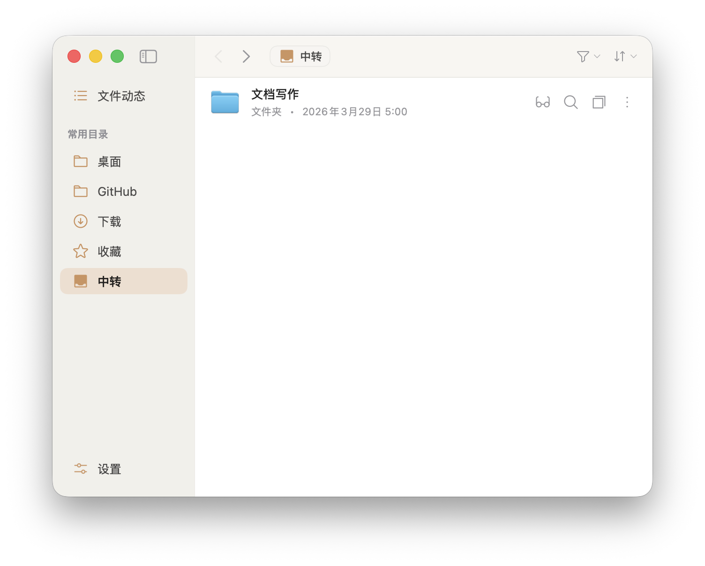

# FileBox

FileBox 是一个 macOS 本地文件快捷访问工具，适合快速打开常用目录、整理下载文件、使用快捷窗口处理临时文件，并通过文件动态关注重点目录里的变化。

这个公开仓库用于发布 FileBox 安装包、维护公开官网和 CLI 文档。FileBox App 主体源码不在这个仓库中。

官网地址：[getfilebox.app](https://getfilebox.app)

## 下载与安装

**下载软件**：[前往 Releases](https://github.com/walnut-a/FileBox-Public/releases) 下载最新版本。

**系统要求**：当前安装包适用于 macOS 14.0+ 的 Apple Silicon Mac。

**安装方法**：打开 DMG 文件后，将 FileBox 拖入 Applications 文件夹。

FileBox 完全在本地运行。它提供快捷访问、文件动态和路径查询能力，不会主动删除、移动或修改用户文件。

## 这个仓库包含什么

| 内容 | 说明 |
| --- | --- |
| [Releases](https://github.com/walnut-a/FileBox-Public/releases) | FileBox 正式安装包 |
| [`site`](./site) | getfilebox.app 官网源码 |
| [`docs/agent-cli-and-skill.md`](./docs/agent-cli-and-skill.md) | FileBox CLI 使用说明 |
| [`scripts/check_no_secrets.sh`](./scripts/check_no_secrets.sh) | 公开仓库安全检查脚本 |

## CLI

安装 FileBox 后，可以在应用内打开 `设置` -> `通用` -> `命令行工具`，安装只读 FileBox CLI。它在终端里的命令名是 `filebox`。

FileBox CLI 的作用是把 FileBox 里已经配置好的常用目录和文件动态输出给终端、脚本或 Agent。它只返回路径和元数据，不会删除、移动、重命名或修改文件。

CLI 目前主要提供三类能力：

- 查询常用目录：查看 FileBox 左侧常用目录，以及这些目录是否被文件动态监控。
- 查询文件动态：读取用户关注目录里的最新文件变化，支持关注后缀和全部动态两种视图。
- 输出可自动化的数据：支持 JSON 和纯路径输出，方便 Agent、Raycast、Alfred 或脚本继续处理。

常用命令：

```bash
filebox folders --json
filebox activity --focused --json --limit 20
filebox activity --all --json --limit 50
```

更多示例见 [FileBox CLI 使用说明](./docs/agent-cli-and-skill.md)。

## 核心功能

### 快捷窗口

FileBox 提供一个轻量快捷窗口，可以通过全局快捷键呼出，在不打断当前工作的情况下快速访问常用文件夹。


### 常用目录

可以把下载、桌面、项目目录、素材目录等路径加入左侧常用目录，减少反复在 Finder 中查找路径的时间。



### 文件动态

FileBox 可以关注配置目录中的文件变化，并按目录分组展示最近更新的文件。用户可以通过关注后缀优先查看更重要的文件类型，例如 `md`、`app`、`dmg`、`pdf`。

### 中转与收藏

中转适合临时放置稍后要处理的文件，收藏适合固定常用文件或素材。拖拽行为可以在设置中配置为复制或移动。

## 维护检查

公开仓库提交或发布前运行：

```bash
npm run check:release
```

这会检查：

- 官网资源和更新清单测试
- 公开仓库内容结构
- 公开文件中是否包含敏感凭据

本地配置 `.githooks/pre-push` 后，执行 `git push` 前会自动运行同一套检查。

官网本地构建：

```bash
npm run site:build
```
